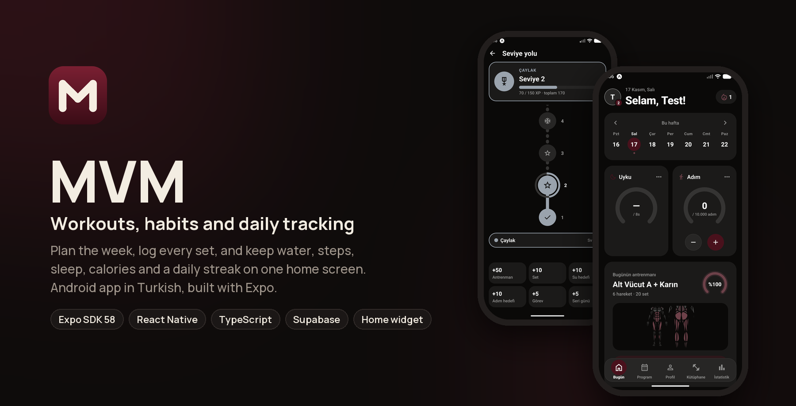
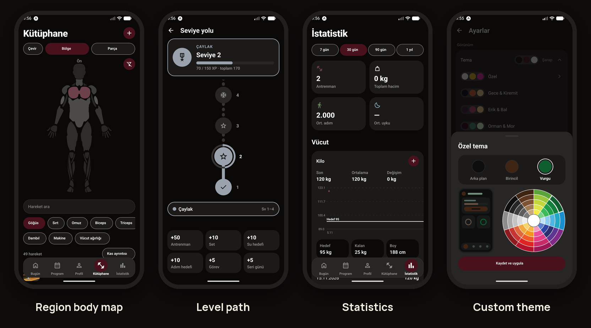
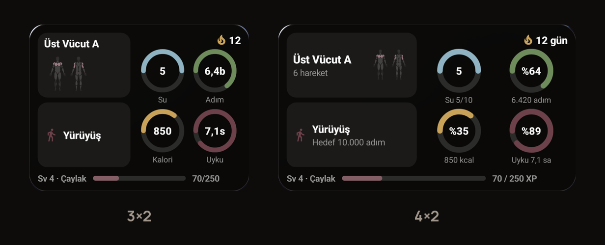
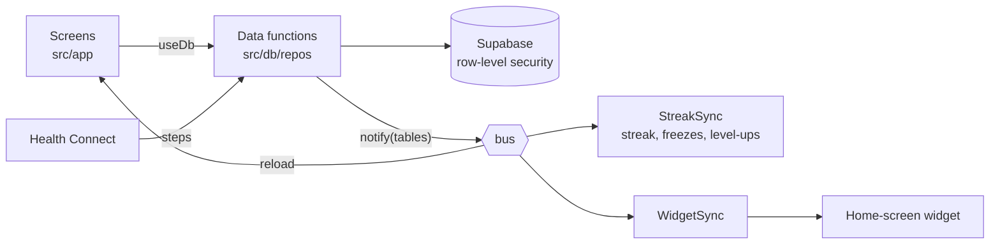
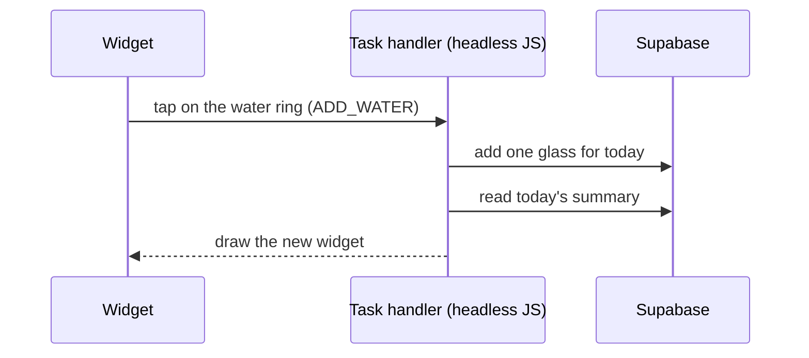
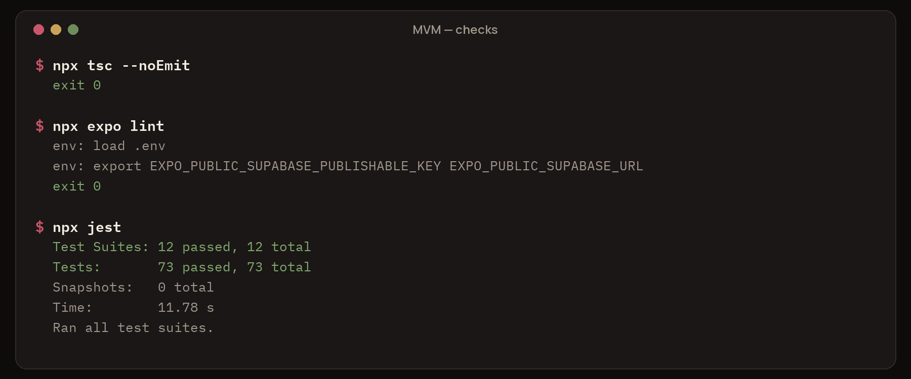

<p align="center">
  
</p>

<p align="center">
  <a href="#demo">Demo</a> · <a href="#what-it-does">What it does</a> · <a href="#home-screen-widget">Widget</a> · <a href="#how-it-works">How it works</a> · <a href="#run-it">Run it</a> · <a href="#türkçe">Türkçe</a>
</p>

MVM is a personal Android app that keeps a strength-training program and the small daily habits around it in one place. You plan the week, log every set while you train, and follow water, steps, sleep and calories on the same home screen; a daily streak and a level path tie it together. The interface is in Turkish.

**Download:** `app-release.apk` from the [latest release](https://github.com/huseyinbaranisik/MVM/releases/latest). Open it on the phone and allow installing from that source; a newer version installs over the old one and your data stays in your account.

**Built with:** Expo SDK 58 (React Native 0.88, TypeScript) · data in Supabase · Health Connect for steps · a native home-screen widget.

## Demo

<p align="center"></p>

<p align="center"><sub><b>Fig. 2</b> · A real recording from the Android emulator (<code>adb screenrecord</code>, sped up 1.6×): home → library → level path → statistics. The account is a test account, so most numbers are still zero.</sub></p>

<p align="center"></p>

<p align="center"><sub><b>Fig. 3</b> · Region body map, level path, statistics and the custom theme sheet, captured on 18 November 2026.</sub></p>

## What it does

<table>
  <tr><td><b>Weekly program</b></td><td>Each weekday gets one or more items (workout templates, a walk) or a rest day. Templates hold sets, rep ranges, timed holds, rest, per-side work and supersets; exercises are reordered by dragging. Up to 10 templates per account.</td></tr>
  <tr><td><b>Live workout</b></td><td>Previous values next to every set, a scroll wheel for kg and reps, a rest timer with a notification, a stopwatch for timed exercises, a progressive-overload hint, and a summary with duration, volume, volume per muscle group and personal records. Past days are locked.</td></tr>
  <tr><td><b>Exercise library</b></td><td>About 260 exercises. The body map has two modes: whole regions drawn as single shapes, or single muscles. Selecting several muscles finds exercises that train all of them. Each exercise page shows record weight, best estimated 1RM and a progress chart.</td></tr>
  <tr><td><b>Daily trackers</b></td><td>Water, steps, sleep and calories as rings with 7-day bars and history charts. Steps come from Health Connect when it is on the phone (permission is asked once, on first launch); otherwise the phone's step sensor counts while the app is open.</td></tr>
  <tr><td><b>Tasks</b></td><td>A checklist on the home screen. A task is daily (only on the chosen day) or weekly (on the chosen weekdays, every week). An edit mode removes tasks.</td></tr>
  <tr><td><b>Streak and level</b></td><td>A workout day counts when the workout is finished; a rest day with the step goal or the checklist. Workouts, sets, tasks and goals give XP; nine ranks from Çaylak to Efsane; a level path from 1 to 100 shows each level's reward. A streak freeze (up to 3) is earned every 7 days and every 4 levels and covers a missed day on its own.</td></tr>
  <tr><td><b>Statistics</b></td><td>Summary tiles, the weight log with the target weight as a line on the chart, weekly workouts and volume, and water, steps, calories and sleep over 7, 30 or 90 days or a year.</td></tr>
  <tr><td><b>Look and feel</b></td><td>Fifteen themes plus a custom one picked from a colour wheel with a live preview; a home-screen layout editor where cards are dragged on a phone preview; sound effects that can be turned off; taps on water, steps and tasks show at once and sync in the background.</td></tr>
</table>

## Home screen widget

<p align="center"></p>

<p align="center"><sub><b>Fig. 4</b> · The widget at 3×1, 3×2 and 4×2 on the emulator, filled with sample data from a demo build (<code>EXPO_PUBLIC_WIDGET_DEMO=1</code>), because the test account cannot sign in on the emulator build.</sub></p>

Long-press the home screen → Widgets → MVM. Today's programs are on the left (a workout shows the muscles it trains), the rings on the right, the streak in the top corner and the level with its XP bar at the bottom. Tapping the water ring adds a glass without opening the app; anything else opens it. The widget redraws whenever the app writes something it shows, and every 30 minutes.

## How it works

The screens live in `src/app/` (Expo Router, one file per screen). Everything you create is stored in Supabase; every table has the row-level security rule `user_id = auth.uid()`, so a signed-in user only reads and writes their own rows. The schema is in [`supabase/migrations/`](supabase/migrations/). The exercise catalogue, the body map and the food list ship inside the app (`src/data/`), so the library opens without the network.



Each data function announces the tables it wrote to; only the screens that read those tables reload. The streak is recomputed from the raw logs (`src/services/streakService.ts`, a pure function) and only the days whose status changed are written back. Rules that are easy to get wrong (streak, XP and level rewards, theme colours, calorie goal, personal records) are plain functions covered by the Jest tests in Fig. 5.



<p align="center"></p>

<p align="center"><sub><b>Fig. 5</b> · Real output on 18 November 2026. The raw logs are in <a href="assets/src/"><code>assets/src/checks-*.txt</code></a>.</sub></p>

### Why this way?

| Decision | Why |
|---|---|
| Catalogue in the app, your data in Supabase | Browsing 260 exercises should not depend on the connection; what you log should survive a lost phone. |
| Region shapes merged ahead of time | `scripts/build-body-regions.py` joins each region's muscles into one outline, so the region map has no seams or bulges. |
| Themes from three colours | Every surface and text colour is derived, so a palette (or the custom theme) is three values. |
| Freezes from level-ups are stored, not recomputed | Level depends on XP, XP on the streak and the streak on freezes; storing the grant date breaks that loop. |
| Template limit enforced in the database too | A trigger refuses an 11th template even if the app check is bypassed. |

## Run it

```bash
npm install
```

Put your own Supabase project in `.env` (the publishable key is meant for the client; access is limited by row-level security):

```
EXPO_PUBLIC_SUPABASE_URL=https://<project>.supabase.co
EXPO_PUBLIC_SUPABASE_PUBLISHABLE_KEY=sb_publishable_...
```

Apply `supabase/migrations/` to the project (`supabase db push`, or the SQL editor), then:

```bash
npx expo start
```

Checks, as in Fig. 5:

```bash
npx tsc --noEmit
```

```bash
npx expo lint
```

```bash
npx jest
```

Release APK: `npx expo prebuild --platform android`, then `gradlew.bat assembleRelease` in `android/`; the file lands in `android/app/build/outputs/apk/release/`.

The README figures are rendered by `tools/render_figures.py` from the screenshots and the recording in `assets/src/`; the app icon by `tools/make_logo.py`; the sounds by `tools/make_sounds.py`.

> [!WARNING]
> On Windows the native build fails when the project path contains non-ASCII characters (for example `Masaüstü`), and the Ninja that ships with the Android SDK's CMake cannot handle the long codegen paths. Build from an ASCII path such as `C:\dev\mvm`, and point `cmake.dir` in `android/local.properties` to a CMake whose `bin/ninja.exe` is 1.12 or newer.

> [!NOTE]
> The app needs a connection; without one it shows a "server unreachable" screen. Expo Go has no Health Connect, widget or sound modules, so those parts only work in the APK or a development build. The APK is built for 64-bit ARM phones. The theme is stored on the device, not in the account.

## Credits

- Exercise data and images: [yuhonas/free-exercise-db](https://github.com/yuhonas/free-exercise-db) (Unlicense). Body-map drawings: [MuscleMap](https://github.com/melihcolpan/MuscleMap) by Melih Colpan (MIT). Food values: USDA FoodData Central (public domain). Details in [`CREDITS.md`](CREDITS.md).
- Design ideas (weekly calendar card, mini body map on workout cards) from [openGym](https://github.com/DuarteSantos8/openGym); no code was copied.
- Fonts in the figures: [Manrope](https://fonts.google.com/specimen/Manrope) and [IBM Plex Mono](https://fonts.google.com/specimen/IBM+Plex+Mono), SIL Open Font License ([`tools/fonts/`](tools/fonts/)). Sound effects are synthesised by `tools/make_sounds.py`.
- The name and numbers in the screenshots belong to a test account.

---

## Türkçe

MVM, bir kuvvet antrenmanı programını ve çevresindeki küçük günlük alışkanlıkları tek yerde toplayan kişisel bir Android uygulaması. Haftayı planlıyor, antrenmanda her seti kaydediyor; su, adım, uyku ve kaloriyi aynı ana ekranda takip ediyorsun. Günlük seri ve seviye yolu hepsini birbirine bağlıyor.

**İndir:** [Son sürümden](https://github.com/huseyinbaranisik/MVM/releases/latest) `app-release.apk`. Telefonda aç ve o kaynaktan yüklemeye izin ver; yeni sürüm eskisinin üzerine kurulur, veriler hesabında kalır.

**Teknoloji:** Expo SDK 58 (React Native 0.88, TypeScript) · veriler Supabase'de · adımlar için Health Connect · yerel ana ekran widget'ı.

### Demo

Şekil 2, Android emülatöründen gerçek bir kayıt (`adb screenrecord`, 1,6 kat hızlı): ana ekran → kütüphane → seviye yolu → istatistik. Şekil 3'te bölge mankeni, seviye yolu, istatistik ve özel tema penceresi var. Hesap bir test hesabı, sayıların çoğu henüz sıfır.

### Neler yapıyor

<table>
  <tr><td><b>Haftalık program</b></td><td>Her güne bir ya da birden fazla öğe (antrenman şablonu, yürüyüş) ya da dinlenme. Şablonlarda set, tekrar aralığı, süreli hareket, dinlenme, tek taraf ve süperset; hareketler sürükleyerek sıralanır. Hesap başına en fazla 10 şablon.</td></tr>
  <tr><td><b>Canlı antrenman</b></td><td>Her setin yanında önceki değerler, kg ve tekrar için kaydırmalı seçici, bildirimli dinlenme sayacı, süreli hareketler için kronometre, progressive overload önerisi; süre, hacim, kas grubuna göre hacim ve kişisel rekorlarla özet. Geçmiş günler kilitli.</td></tr>
  <tr><td><b>Hareket kütüphanesi</b></td><td>Yaklaşık 260 hareket. Vücut haritasının iki modu var: tek şekil olarak çizilen bölgeler ya da tek tek kaslar. Birden fazla kas seçilince hepsini çalıştıran hareketler listelenir. Her hareketin sayfasında rekor ağırlık, en iyi tahmini 1RM ve ilerleme grafiği.</td></tr>
  <tr><td><b>Günlük takip</b></td><td>Su, adım, uyku ve kalori halkaları; 7 günlük çubuklar ve geçmiş grafikleri. Telefonda Health Connect varsa adımlar oradan gelir (izin ilk açılışta bir kez istenir); yoksa telefonun adım sensörü uygulama açıkken sayar.</td></tr>
  <tr><td><b>Görevler</b></td><td>Ana ekranda bir liste. Görev günlük (yalnızca seçilen gün) ya da haftalık (seçilen günlerde her hafta) olur. Düzenle modunda silinir.</td></tr>
  <tr><td><b>Seri ve seviye</b></td><td>Antrenman günü antrenman bitince, dinlenme günü adım hedefi ya da görev listesiyle tamamlanır. Antrenman, set, görev ve hedefler XP kazandırır; Çaylak'tan Efsane'ye dokuz rank; 1'den 100'e seviye yolu her seviyenin ödülünü gösterir. Seri dondurma hakkı (en fazla 3) 7 günde bir ve her 4 seviyede bir kazanılır, kaçırılan günü kendiliğinden korur.</td></tr>
  <tr><td><b>İstatistik</b></td><td>Özet kutuları, kilo kayıtları ve grafikte çizgi olarak hedef kilo, haftalık antrenman ve hacim; su, adım, kalori ve uyku 7, 30, 90 gün ya da 1 yıl.</td></tr>
  <tr><td><b>Görünüm</b></td><td>On beş tema ve renk çemberinden canlı önizlemeyle seçilen özel tema; kartların telefon önizlemesinde sürüklenerek dizildiği ana ekran düzeni; kapatılabilen ses efektleri; su, adım ve görev dokunuşları anında görünür, arka planda kaydedilir.</td></tr>
</table>

### Ana ekran widget'ı

Ana ekrana uzun bas → Widget'lar → MVM. Boyutu 3×1, 3×2 ya da 4×2 olabilir (Şekil 4). Solda günün programları (antrenmanda çalışan kaslar mini mankende), sağda halkalar, köşede seri, altta seviye ve XP çubuğu. Su halkasına dokununca uygulamayı açmadan bir bardak eklenir; başka bir yere dokununca uygulama açılır. Şekil 4'teki veriler örnek veridir: emülatör sürümünde test hesabıyla giriş yapılmadığı için widget `EXPO_PUBLIC_WIDGET_DEMO=1` ile derlenen sürümle görüntülendi.

### Nasıl çalışıyor

Ekranlar `src/app/` altında (Expo Router, ekran başına bir dosya). Oluşturduğun her şey Supabase'de; her tabloda `user_id = auth.uid()` satır güvenliği kuralı var, oturum açan kullanıcı yalnızca kendi satırlarını okur ve yazar. Şema [`supabase/migrations/`](supabase/migrations/) altında. Hareket kataloğu, vücut haritası ve yiyecek listesi uygulamanın içinde (`src/data/`), kütüphane ağı beklemeden açılır.

Her veri fonksiyonu yazdığı tabloları duyurur; yalnızca o tabloları okuyan ekranlar yenilenir (yukarıdaki ilk diyagram). Seri ham kayıtlardan yeniden hesaplanır (`src/services/streakService.ts`, saf fonksiyon) ve yalnızca durumu değişen günler geri yazılır. Kolay yanlış yapılan kurallar (seri, XP ve seviye ödülleri, tema renkleri, kalori hedefi, kişisel rekorlar) Şekil 5'teki Jest testleriyle denetlenen saf fonksiyonlar.

| Karar | Neden |
|---|---|
| Katalog uygulamada, verin Supabase'de | 260 hareketi gezmek bağlantıya bağlı olmamalı; kaydettiklerin telefon kaybolsa da kalmalı. |
| Bölge şekilleri önceden birleştirilir | `scripts/build-body-regions.py` her bölgenin kaslarını tek kontura çevirir, bölge haritasında dikiş ya da çıkıntı kalmaz. |
| Temalar üç renkten | Tüm yüzey ve yazı renkleri türetilir; bir palet (ya da özel tema) üç değerdir. |
| Seviye ödülü dondurmalar saklanır | Seviye XP'ye, XP seriye, seri dondurmaya bağlı; hakkın verildiği günü saklamak bu döngüyü kırar. |
| Şablon sınırı veritabanında da | Uygulamadaki kontrol aşılsa bile bir tetikleyici 11. şablonu reddeder. |

### Çalıştırma

`npm install`, ardından kendi Supabase projeni `.env` dosyasına yaz (yukarıdaki iki satır), `supabase/migrations/` dosyalarını projeye uygula ve `npx expo start`. Kontroller: `npx tsc --noEmit`, `npx expo lint`, `npx jest`. APK: `npx expo prebuild --platform android`, sonra `android/` içinde `gradlew.bat assembleRelease`.

> [!WARNING]
> Windows'ta proje yolunda ASCII olmayan karakter (ör. `Masaüstü`) varsa yerel derleme başarısız olur ve Android SDK'nın CMake'iyle gelen Ninja uzun yolları kaldıramaz. `C:\dev\mvm` gibi bir yoldan derle ve `android/local.properties` içindeki `cmake.dir`'i `bin/ninja.exe` sürümü 1.12 ya da üstü olan bir CMake'e yönlendir.

> [!NOTE]
> Uygulama bağlantı ister; bağlantı yoksa "sunucuya ulaşılamadı" ekranı çıkar. Expo Go'da Health Connect, widget ve ses modülleri yok; bunlar yalnızca APK'da ya da development build'de çalışır. APK 64 bit ARM telefonlar içindir. Tema hesapta değil, cihazda saklanır.

### Emeği geçenler

- Hareket verisi ve görselleri: [yuhonas/free-exercise-db](https://github.com/yuhonas/free-exercise-db) (Unlicense). Vücut haritası çizimleri: Melih Colpan'ın [MuscleMap](https://github.com/melihcolpan/MuscleMap) projesi (MIT). Yiyecek değerleri: USDA FoodData Central (kamu malı). Ayrıntılar [`CREDITS.md`](CREDITS.md) içinde.
- Tasarım fikirleri (haftalık takvim kartı, antrenman kartında mini vücut haritası) [openGym](https://github.com/DuarteSantos8/openGym) projesinden; kod kopyalanmadı.
- Görsellerdeki yazı tipleri: [Manrope](https://fonts.google.com/specimen/Manrope) ve [IBM Plex Mono](https://fonts.google.com/specimen/IBM+Plex+Mono), SIL Open Font License. Ses efektleri `tools/make_sounds.py` ile sentezlendi.
- Ekran görüntülerindeki ad ve sayılar bir test hesabına ait.
