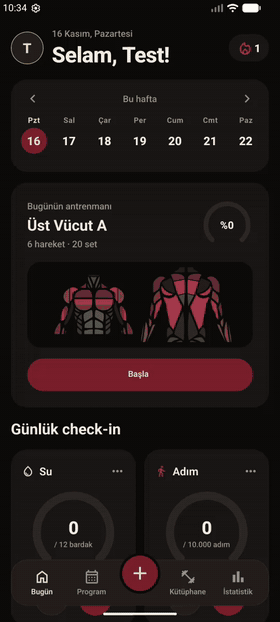
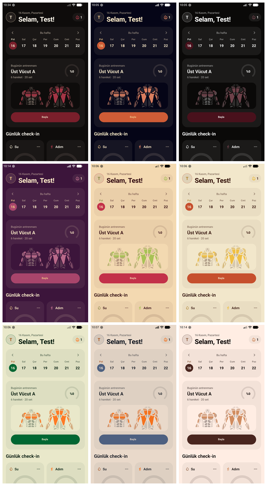
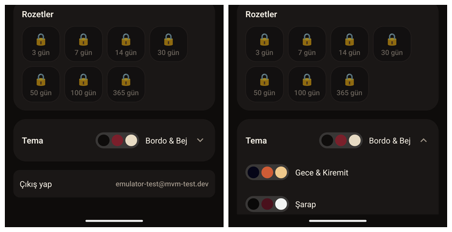
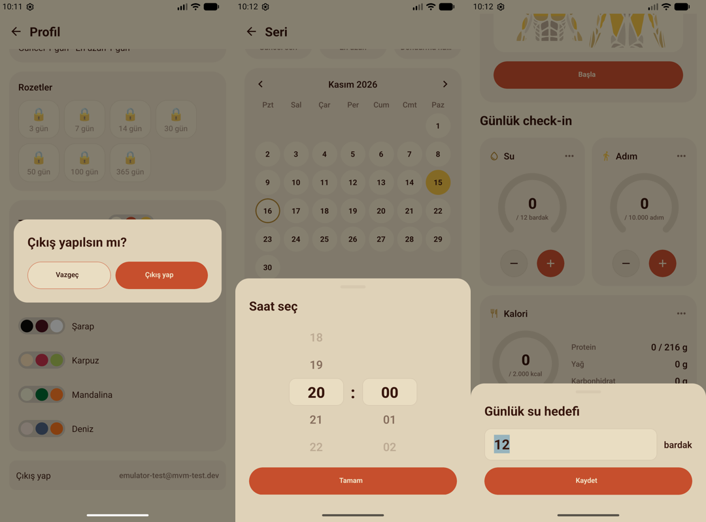

# MVM

Antrenman ve günlük alışkanlık takibini tek uygulamada toplayan, Türkçe arayüzlü kişisel mobil uygulama.
Expo (React Native) ile yazıldı, veriler Supabase'de hesaba bağlı tutulur.

<p align="center">
  
</p>

<p align="center"><a href="docs/media/demo.mp4">Videoyu MP4 olarak izle</a></p>

## Özellikler

**Antrenman**
- Haftalık program: her güne antrenman şablonu, yürüyüş veya dinlenme atanır.
- Şablon düzenleyici: set, tekrar aralığı, süre, dinlenme, tek taraf ve süperset ayarları; sürükleyerek sıralama.
- Aktif antrenman: önceki değerler, kaydırmalı kg/tekrar seçici, dinlenme sayacı ve bildirimi, süreli hareketler için kronometre.
- Progressive overload önerisi, antrenman sonunda hacim ve kişisel rekor (PR) özeti.
- Geçmiş günlerin antrenmanı sonradan doldurulamaz.

**Hareket kütüphanesi**
- ~260 hareket; dokunulabilir vücut haritasından bölgeye veya kas parçasına göre filtreleme.
- Arama, ekipman filtresi, favoriler, kendi hareketini fotoğrafıyla ekleme.

**Günlük takip**
- Su ve adım halkaları, uyku kaydı (yatış, kalkış, kalite) ve yatma hatırlatıcısı.
- Kalori sayacı: hazır yiyecek listesi (USDA değerleri), gram ile kayıt, makrolar, kendi yiyeceğini ekleme, son yenenler.
- Profilden kalori ve protein hedefi önerisi (Mifflin-St Jeor).
- Her takipçi için 2 haftalık / 1 aylık geçmiş grafiği.
- Alışkanlık listesi (haftanın günlerine göre).

**Seri ve profil**
- Antrenman günü antrenmanla, dinlenme günü adım veya alışkanlıkla tamamlanan günlük seri.
- Dondurma hakkı, aylık seri takvimi, rozetler, akşam seri hatırlatması.
- Kilo ve boy kaydı, BMI, kilo grafiği ve hedef çizgisi.

## Temalar

Profil → Tema bölümünden 9 tema arasında seçim yapılır. Seçim cihazda saklanır.

<p align="center">
  
</p>

| | | |
|---|---|---|
| Bordo & Bej | Gece & Kiremit | Şarap |
| Erik & Bal | Karpuz | Domates |
| Mandalina | Deniz | Mocha |

Her tema üç renkten oluşur; uygulamanın diğer renkleri (yüzeyler, çizgiler, metin, kas haritası tonları) bu üç renkten türetilir.

<p align="center">
  
</p>

## Kendi pencereleri

Telefonun hazır uyarı kutusu ve saat seçicisi kullanılmaz. Onay penceresi, kaydırmalı saat seçici, sayı girişi ve kısa bildirimler uygulamanın kendi bileşenleridir ve seçili temanın renklerini alır.

<p align="center">
  
</p>

## Teknolojiler

| Katman | Kullanılan |
|---|---|
| Çatı | Expo SDK 58, React Native 0.88, React 19, TypeScript |
| Yönlendirme | Expo Router (dosya tabanlı, `src/app/`) |
| Veri | Supabase (Postgres + Auth, satır düzeyinde güvenlik) |
| Durum | Zustand |
| Animasyon | Reanimated 4 |
| Grafik ve çizim | react-native-gifted-charts, react-native-svg |
| Diğer | expo-notifications (yerel), expo-sensors (adım), expo-haptics, expo-keep-awake |
| Test | Jest (jest-expo) |

## Kurulum

1. Bağımlılıkları kur:

   ```bash
   npm install
   ```

2. Kök dizindeki `.env` dosyasına kendi Supabase projenin adresini ve publishable anahtarını yaz:

   ```
   EXPO_PUBLIC_SUPABASE_URL=https://<proje>.supabase.co
   EXPO_PUBLIC_SUPABASE_PUBLISHABLE_KEY=sb_publishable_...
   ```

3. `supabase/migrations/` altındaki SQL dosyalarını projene uygula (Supabase CLI ile `supabase db push` ya da panelden SQL Editor).

4. Uygulamayı başlat:

   ```bash
   npx expo start
   ```

İlk girişte varsayılan haftalık program, alışkanlıklar ve hedefler hesaba otomatik yazılır.

## Kontroller

```bash
npx tsc --noEmit
```

```bash
npx expo lint
```

```bash
npx jest
```

## Klasörler

- `src/app/` ekranlar (Expo Router)
- `src/components/` ortak bileşenler; `ui/` altında pencere, panel, buton ve seçiciler
- `src/db/` Supabase istemcisi ve veri fonksiyonları (`repos/`)
- `src/services/` saf hesaplamalar (seri, kalori, antrenman, birimler); testleri `__tests__/` altında
- `src/data/` hareket kataloğu, kas haritası, yiyecek listesi, varsayılan program
- `src/theme/` renk paletleri ve tema seçimi
- `supabase/migrations/` veritabanı şeması

## Kaynaklar

Hareket verisi, vücut haritası çizimleri ve lisansları için [CREDITS.md](CREDITS.md).
