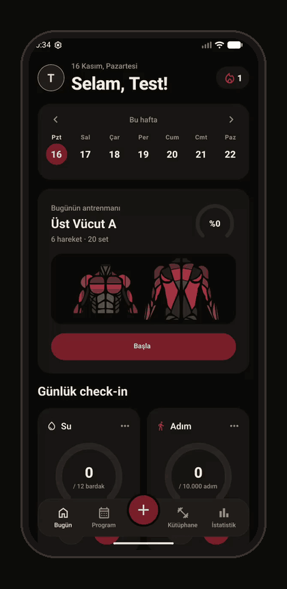

<p align="center">
  
</p>

<p align="center">
  <a href="#demo">Demo</a> · <a href="#what-it-does">What it does</a> · <a href="#home-screen-widget">Widget</a> · <a href="#how-it-works">How it works</a> · <a href="#run-it">Run it</a> · <a href="#türkçe">Türkçe</a>
</p>

MVM is a personal Android app for strength training and daily habits. Plan your week, log your sets, and track water, steps, sleep and calories. A daily streak and a level path keep you going. The interface is in Turkish.

**Download:** `app-release.apk` from the [latest release](https://github.com/huseyinbaranisik/MVM/releases/latest). New versions install over the old one; your data stays in your account.

**Built with:** Expo SDK 58 (React Native 0.88, TypeScript) · Supabase · Health Connect · a native home-screen widget.

## Demo

<p align="center"></p>

<p align="center"><sub><b>Fig. 2</b> · A real recording from the Android emulator (<code>adb screenrecord</code>, sped up 1.6×): home → library → level path → statistics. The account is a test account, so most numbers are still zero.</sub></p>

<p align="center"></p>

<p align="center"><sub><b>Fig. 3</b> · Region body map, level path, statistics and the custom theme sheet, captured on 18 November 2026.</sub></p>

## What it does

<table>
  <tr><td><b>Weekly program</b></td><td>Give each day workouts, a walk or rest. Templates support sets, rep ranges, timed holds, rest, per-side work and supersets. Up to 10 templates.</td></tr>
  <tr><td><b>Live workout</b></td><td>See your previous values, pick kg and reps on a wheel, use the rest timer and stopwatch. A summary shows duration, volume and personal records.</td></tr>
  <tr><td><b>Exercise library</b></td><td>About 260 exercises. Pick regions or single muscles on the body map. Each exercise shows your record, best 1RM and a progress chart.</td></tr>
  <tr><td><b>Daily trackers</b></td><td>Water, steps, sleep and calories as rings and charts. Steps come from Health Connect, or from the phone's sensor while the app is open.</td></tr>
  <tr><td><b>Tasks</b></td><td>A checklist on the home screen. Tasks are daily or weekly.</td></tr>
  <tr><td><b>Streak and level</b></td><td>Finish your workout, or hit your step goal or tasks on a rest day, to keep the streak. Earn XP, climb nine ranks and 100 levels. Streak freezes (up to 3) cover missed days.</td></tr>
  <tr><td><b>Statistics</b></td><td>Weight with a goal line, workouts, volume, water, steps, calories and sleep over 7, 30, 90 days or a year.</td></tr>
  <tr><td><b>Look and feel</b></td><td>Fifteen themes plus a custom one. Drag cards to arrange the home screen. Sound effects can be turned off.</td></tr>
</table>

## Home screen widget

<p align="center"></p>

<p align="center"><sub><b>Fig. 4</b> · The widget at 3×2 and 4×2 on the emulator (3×1 is a single row: plans, water and step rings, streak), filled with sample data from a demo build (<code>EXPO_PUBLIC_WIDGET_DEMO=1</code>), because the test account cannot sign in on the emulator build.</sub></p>

Long-press the home screen → Widgets → MVM. It shows today's programs, rings, streak and level. Tap the water ring to add a glass; tap anywhere else to open the app.

## How it works

Screens are in `src/app/` (Expo Router). Your data is in Supabase; row-level security means each user sees only their own rows. The schema is in [`supabase/migrations/`](supabase/migrations/). The exercise catalogue, body map and food list ship with the app (`src/data/`).

When data changes, only the screens that use it reload. Core rules (streak, XP, themes, calories, records) are pure functions with Jest tests.

<p align="center"></p>

<p align="center"><sub><b>Fig. 5</b> · Real output on 18 November 2026. The raw logs are in <a href="assets/src/"><code>assets/src/checks-*.txt</code></a>.</sub></p>

### Why this way?

| Decision | Why |
|---|---|
| Catalogue in the app, your data in Supabase | The library works offline; your logs survive a lost phone. |
| Region shapes merged ahead of time | `scripts/build-body-regions.py` makes clean outlines with no seams. |
| Themes from three colours | All other colours are derived. |
| Level-up freezes are stored | Avoids a loop between level, XP, streak and freezes. |
| Template limit in the database too | A trigger blocks an 11th template. |

## Run it

```bash
npm install
```

Add your Supabase project to `.env`:

```
EXPO_PUBLIC_SUPABASE_URL=https://<project>.supabase.co
EXPO_PUBLIC_SUPABASE_PUBLISHABLE_KEY=sb_publishable_...
```

Apply `supabase/migrations/` (`supabase db push`), then:

```bash
npx expo start
```

Checks:

```bash
npx tsc --noEmit
```

```bash
npx expo lint
```

```bash
npx jest
```

Release APK: `npx expo prebuild --platform android`, then `gradlew.bat assembleRelease` in `android/`.

README figures: `tools/render_figures.py`. Icon: `tools/make_logo.py`. Sounds: `tools/make_sounds.py`.

> [!WARNING]
> On Windows, build from an ASCII path such as `C:\dev\mvm`, and use a CMake with Ninja 1.12 or newer (`cmake.dir` in `android/local.properties`).

> [!NOTE]
> The app needs a connection. Health Connect, the widget and sounds don't work in Expo Go. The APK is for 64-bit ARM phones. The theme is saved on the device.

## Credits

- Exercise data and images: [yuhonas/free-exercise-db](https://github.com/yuhonas/free-exercise-db) (Unlicense). Body map: [MuscleMap](https://github.com/melihcolpan/MuscleMap) by Melih Colpan (MIT). Food values: USDA FoodData Central. See [`CREDITS.md`](CREDITS.md).
- Design ideas from [openGym](https://github.com/DuarteSantos8/openGym); no code copied.
- Fonts: [Manrope](https://fonts.google.com/specimen/Manrope) and [IBM Plex Mono](https://fonts.google.com/specimen/IBM+Plex+Mono) (SIL OFL, [`tools/fonts/`](tools/fonts/)).
- Screenshots use a test account.

---

## Türkçe

MVM, kuvvet antrenmanı ve günlük alışkanlıklar için kişisel bir Android uygulaması. Haftanı planla, setlerini kaydet; su, adım, uyku ve kaloriyi takip et. Günlük seri ve seviye yolu seni motive eder.

**İndir:** [Son sürümden](https://github.com/huseyinbaranisik/MVM/releases/latest) `app-release.apk`. Yeni sürüm eskisinin üzerine kurulur; verilerin hesabında kalır.

**Teknoloji:** Expo SDK 58 (React Native 0.88, TypeScript) · Supabase · Health Connect · ana ekran widget'ı.

### Demo

Şekil 2: emülatörden gerçek kayıt. Şekil 3: bölge mankeni, seviye yolu, istatistik ve özel tema. Test hesabı olduğu için sayıların çoğu sıfır.

### Neler yapıyor

<table>
  <tr><td><b>Haftalık program</b></td><td>Her güne antrenman, yürüyüş ya da dinlenme ver. Şablonlarda set, tekrar, süreli hareket, dinlenme, tek taraf ve süperset var. En fazla 10 şablon.</td></tr>
  <tr><td><b>Canlı antrenman</b></td><td>Önceki değerleri gör, kg ve tekrarı kaydırarak seç, dinlenme sayacı ve kronometreyi kullan. Sonunda süre, hacim ve rekorlarla özet.</td></tr>
  <tr><td><b>Hareket kütüphanesi</b></td><td>Yaklaşık 260 hareket. Haritada bölge ya da tek kas seç. Her harekette rekor, en iyi 1RM ve ilerleme grafiği.</td></tr>
  <tr><td><b>Günlük takip</b></td><td>Su, adım, uyku ve kalori halkaları ve grafikleri. Adımlar Health Connect'ten ya da uygulama açıkken telefon sensöründen gelir.</td></tr>
  <tr><td><b>Görevler</b></td><td>Ana ekranda liste. Görevler günlük ya da haftalık.</td></tr>
  <tr><td><b>Seri ve seviye</b></td><td>Antrenmanı bitir, dinlenme gününde adım hedefini ya da görevleri tamamla. XP kazan, dokuz rank ve 100 seviye. Dondurma hakları (en fazla 3) kaçan günü korur.</td></tr>
  <tr><td><b>İstatistik</b></td><td>Hedef çizgili kilo grafiği; antrenman, hacim, su, adım, kalori ve uyku. 7, 30, 90 gün ya da 1 yıl.</td></tr>
  <tr><td><b>Görünüm</b></td><td>On beş tema ve özel tema. Ana ekran kartlarını sürükleyerek diz. Ses efektleri kapatılabilir.</td></tr>
</table>

### Ana ekran widget'ı

Ana ekrana uzun bas → Widget'lar → MVM. Boyut 3×1, 3×2 ya da 4×2. Günün programları, halkalar, seri ve seviye görünür. Su halkasına dokun, bir bardak eklensin; başka yere dokun, uygulama açılsın. Şekil 4'teki veriler örnektir.

### Nasıl çalışıyor

Ekranlar `src/app/` altında (Expo Router). Verilerin Supabase'de; satır güvenliği sayesinde herkes yalnızca kendi verisini görür. Şema [`supabase/migrations/`](supabase/migrations/) altında. Hareket kataloğu, vücut haritası ve yiyecek listesi uygulamanın içinde (`src/data/`).

Veri değişince yalnızca onu kullanan ekranlar yenilenir. Temel kurallar (seri, XP, tema, kalori, rekor) Jest testli saf fonksiyonlar.

| Karar | Neden |
|---|---|
| Katalog uygulamada, verin Supabase'de | Kütüphane çevrimdışı çalışır; kayıtların telefon kaybolsa da kalır. |
| Bölge şekilleri önceden birleştirilir | `scripts/build-body-regions.py` dikişsiz konturlar üretir. |
| Temalar üç renkten | Diğer tüm renkler türetilir. |
| Seviye dondurmaları saklanır | Seviye, XP, seri ve dondurma arasındaki döngüyü kırar. |
| Şablon sınırı veritabanında da | Bir tetikleyici 11. şablonu engeller. |

### Çalıştırma

`npm install`, `.env` dosyasına Supabase bilgilerini yaz, `supabase/migrations/` dosyalarını uygula, sonra `npx expo start`. Kontroller: `npx tsc --noEmit`, `npx expo lint`, `npx jest`. APK: `npx expo prebuild --platform android`, sonra `android/` içinde `gradlew.bat assembleRelease`.

> [!WARNING]
> Windows'ta `C:\dev\mvm` gibi ASCII bir yoldan derle ve Ninja 1.12+ içeren bir CMake kullan (`android/local.properties` içinde `cmake.dir`).

> [!NOTE]
> Uygulama bağlantı ister. Health Connect, widget ve sesler Expo Go'da çalışmaz. APK 64 bit ARM telefonlar içindir. Tema cihazda saklanır.

### Emeği geçenler

- Hareket verisi ve görselleri: [yuhonas/free-exercise-db](https://github.com/yuhonas/free-exercise-db) (Unlicense). Vücut haritası: Melih Colpan'ın [MuscleMap](https://github.com/melihcolpan/MuscleMap) projesi (MIT). Yiyecek değerleri: USDA FoodData Central. Ayrıntılar [`CREDITS.md`](CREDITS.md) içinde.
- Tasarım fikirleri [openGym](https://github.com/DuarteSantos8/openGym) projesinden; kod kopyalanmadı.
- Yazı tipleri: [Manrope](https://fonts.google.com/specimen/Manrope) ve [IBM Plex Mono](https://fonts.google.com/specimen/IBM+Plex+Mono) (SIL OFL).
- Ekran görüntüleri bir test hesabına ait.
