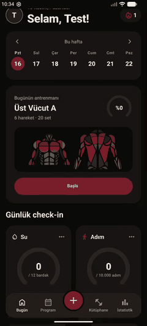
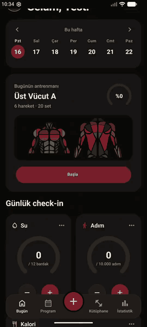
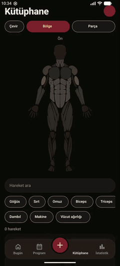
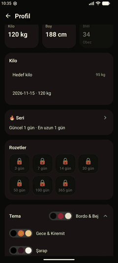
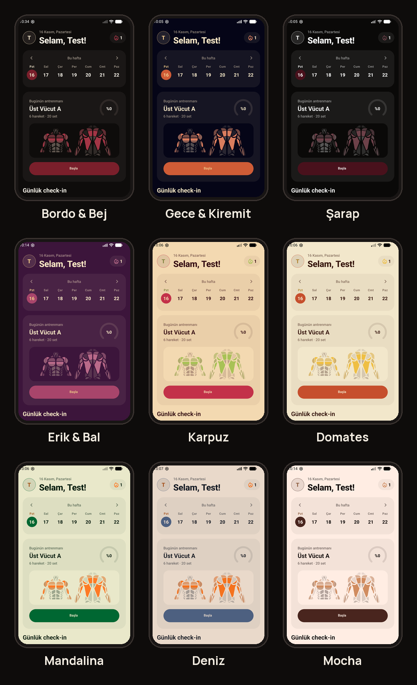
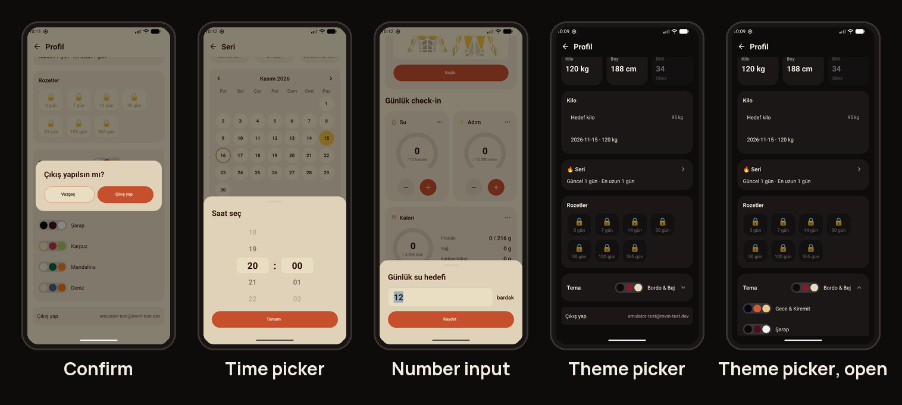

<p align="center">
  
</p>

<p align="center">
  <a href="#demo">Demo</a> · <a href="#what-it-does">What it does</a> · <a href="#themes">Themes</a> · <a href="#how-it-works">How it works</a> · <a href="#run-it">Run it</a> · <a href="#türkçe">Türkçe</a>
</p>

MVM is a personal mobile app that keeps a strength-training program and the small daily habits around it in one place. You plan the week, log sets while you train, and track water, steps, sleep and calories on the same home screen; a daily streak ties it together. The interface is in Turkish.

**Built with:** Expo SDK 58 (React Native 0.88, TypeScript) · data in Supabase · runs in Expo Go or a development build.

**Android:** download `app-release.apk` from the [latest release](https://github.com/huseyinbaranisik/MVM/releases/latest), open it on the phone and allow installing from that source. For background steps, open the Steps card menu and choose "Health Connect'e bağlan"; for the widget, long-press the home screen → Widgets → MVM.

## Demo

<p align="center"></p>

<p align="center"><sub><b>Fig. 2</b> · A real recording from the Android emulator (<code>adb screenrecord</code>, sped up 1.5×). Home → Program → Library → a muscle → Profile → theme picker → Erik & Bal. The few seconds of the development reload after the theme change are cut.</sub></p>

<p align="center"></p>

<p align="center"><sub><b>Fig. 3</b> · Real output on 16 November 2026: type check, lint and the Jest suite (48 tests). The raw logs are in <a href="assets/src/"><code>assets/src/checks-*.txt</code></a>.</sub></p>

<table>
  <tr>
    <td align="center" width="25%"><br><sub>Home: today's plan and trackers</sub></td>
    <td align="center" width="25%"><br><sub>Weekly program</sub></td>
    <td align="center" width="25%"><br><sub>Library: tap a muscle</sub></td>
    <td align="center" width="25%"><br><sub>Switching theme</sub></td>
  </tr>
</table>
<p align="center"><sub><b>Fig. 4</b> · Short clips from the same recording.</sub></p>

## What it does

<table>
  <tr><td><b>Weekly program</b></td><td>Each weekday gets one or more items (workout templates, a walk) or a rest day; a new account starts with an empty week. Templates hold sets, rep ranges, timed holds, rest, per-side work and supersets; exercises are reordered by dragging. Up to 10 templates per account.</td></tr>
  <tr><td><b>Live workout</b></td><td>Previous values next to every set, a scroll wheel for kg and reps, a rest timer with a notification, a stopwatch for timed exercises, a progressive-overload hint, and a summary with duration, volume (with a comparison to the last session of the same template), volume per muscle group, the best set per exercise and personal records. Rest ±15 s shortens the bar proportionally. Past days are locked: yesterday's workout cannot be filled in today.</td></tr>
  <tr><td><b>Exercise library</b></td><td>About 260 exercises. The body map has two modes: whole regions drawn as single shapes, or single muscles. Tapping it selects the region or muscle below and colours it; several muscles can be selected at once to find exercises that train all of them. Search, equipment filters, favourites and your own exercises with a photo. "Add to plan" adds an exercise to a template. Each exercise page shows progress: record weight, best estimated 1RM, and a chart of heaviest set, 1RM or volume per session.</td></tr>
  <tr><td><b>Home screen widget</b></td><td>"MVM Bugün": streak, level, today's plan, water with a + button to add a glass, and steps, without opening the app. Resizable: 3×1, 3×2 or 4×2.</td></tr>
  <tr><td><b>Daily trackers</b></td><td>Water and steps as rings, sleep with bed time, wake time and quality, a bedtime reminder, and a 2-week / 1-month history chart for each. Steps can come from Health Connect, so steps counted by the phone while the app is closed are picked up when it opens.</td></tr>
  <tr><td><b>Calories</b></td><td>A built-in food list with values per 100 g or 100 ml (USDA FoodData Central), grouped into categories, logging by grams or millilitres, macros, your own foods, recently eaten foods first, and a calorie and protein goal suggested from your profile (Mifflin-St Jeor).</td></tr>
  <tr><td><b>Streak</b></td><td>A workout day counts when the workout is finished; a rest day counts with the step goal or the habit checklist. Freezes (up to 3, earned every 7 days and every 4 levels) cover a missed day automatically, plus a monthly calendar and an evening reminder if the day is not done yet.</td></tr>
  <tr><td><b>XP and level</b></td><td>Finished workouts, sets, habits, water and step goals and streak days give XP. Nine ranks (Çaylak → Efsane); tapping the level opens a level path from 1 to 100 that shows each level's reward.</td></tr>
  <tr><td><b>Profile</b></td><td>Photo, a one-line summary with an edit panel, a monthly activity calendar, weight, target weight and BMI, a home-screen layout editor where cards are dragged around a phone preview, and Settings (theme, rest times, sound effects, data export, account deletion).</td></tr>
  <tr><td><b>Statistics</b></td><td>Summary tiles (workouts, total volume, average steps and sleep), a body section with the weight log and the target weight as a line on the chart, weekly workouts and volume as bars, and water, steps, calories and sleep charts, over 7 days, 30 days, 90 days or a year.</td></tr>
</table>

## Themes

Fifteen themes, chosen under Profile → Ayarlar → Tema (the figure below shows the earlier nine). Each one is three colours; every other colour in the app (surfaces, dividers, text, muscle-map tones) is derived from those three.

<p align="center"></p>

<p align="center"><sub><b>Fig. 5</b> · Bordo & Bej (default), Gece & Kiremit, Şarap, Erik & Bal, Karpuz, Domates, Mandalina, Deniz, Mocha. Erik & Bal and Mocha came as two-colour palettes; the third colour (rose <code>#A8456B</code>, caramel <code>#D08C60</code>) was added to match.</sub></p>

The app does not use the phone's own alert box or time picker. Confirmations, the time wheel, number input and toasts are its own components, so they follow the theme.

<p align="center"></p>

<p align="center"><sub><b>Fig. 6</b> · The app's own dialogs (the first three in the Domates theme).</sub></p>

## How it works

The screens live in `src/app/` (Expo Router, one file per screen). Everything you create is stored in Supabase: workouts and sets, templates and the weekly plan, trackers, sleep, food logs, measurements, streak and settings. Every table has a row-level security rule `user_id = auth.uid()`, so a signed-in user only ever reads and writes their own rows; the schema is in [`supabase/migrations/`](supabase/migrations/).

The exercise catalogue, the muscle map and the built-in food list ship inside the app (`src/data/`), like the exercise images. Only your own exercises, foods and favourites go to the database. The library therefore opens without waiting for the network.

Screens read data with a small `useDb` hook. Each data function announces the tables it wrote to, and only the screens that read those tables reload. The streak is recomputed from the raw logs whenever a relevant table changes, and only the days whose status changed are written back.

Calculations that are easy to get wrong (streak rules, calorie goal, theme colours, personal records, the exercise catalogue) are plain functions in `src/services/` and `src/theme/`, covered by the Jest tests in Fig. 3.

### Why this way?

| Decision | Why |
|---|---|
| Catalogue in the app, your data in Supabase | Browsing 260 exercises should not depend on the connection; what you log should survive a lost phone. |
| Food logs copy the food's values | Editing or deleting a food later does not change past days. |
| Region in Frankfurt (`eu-central-1`) | The first project was in Tokyo; from Turkey that is roughly 5× the round-trip time on every tap. |
| Themes from three colours | Adding a palette is one line; the derived surfaces and text keep contrast in both light and dark themes. |
| Theme change reloads the app | Styles are created once at start-up; reloading is simpler and safer than threading the theme through every component. |

## Run it

```bash
npm install
```

Put your own Supabase project in `.env` (the publishable key is meant for the client; access is limited by the row-level security rules):

```
EXPO_PUBLIC_SUPABASE_URL=https://<project>.supabase.co
EXPO_PUBLIC_SUPABASE_PUBLISHABLE_KEY=sb_publishable_...
```

Apply `supabase/migrations/` to the project (Supabase CLI `supabase db push`, or the SQL editor), then:

```bash
npx expo start
```

On the first sign-in the default weekly program, habits and goals are written to the account. Checks, as in Fig. 3:

```bash
npx tsc --noEmit
```

```bash
npx expo lint
```

```bash
npx jest
```

The README figures are rendered by `tools/render_figures.py` from the screenshots and recording in `assets/src/` (`uv run --with pillow --with imageio-ffmpeg python tools/render_figures.py`).

Release APK: `npx expo prebuild --platform android`, then `gradlew.bat assembleRelease` in `android/`; the file lands in `android/app/build/outputs/apk/release/`.

> [!WARNING]
> On Windows the native build fails when the project path contains non-ASCII characters (for example `Masaüstü`), and the Ninja 1.10.2 that ships with the Android SDK's CMake 3.22.1 cannot handle the long codegen paths. Build from an ASCII path such as `C:\dev\mvm`, and point `cmake.dir` in `android/local.properties` to a CMake copy whose `bin/ninja.exe` is Ninja 1.12 or newer.

> [!NOTE]
> The app needs a connection: every screen reads from Supabase, and without one it shows a "server unreachable" screen. Without Health Connect, steps are counted only while the app is open. The APK is built for 64-bit ARM phones only (almost all current phones); it does not run on x86 emulators. The theme choice is stored on the device, not in the account.

## Credits

- Exercise data and images: [yuhonas/free-exercise-db](https://github.com/yuhonas/free-exercise-db) (Unlicense). Body-map drawings: [MuscleMap](https://github.com/melihcolpan/MuscleMap) by Melih Colpan (MIT). Food values: USDA FoodData Central (public domain). Details and licence texts in [`CREDITS.md`](CREDITS.md).
- Design ideas (weekly calendar card, mini body map on workout cards, keeping the screen on during a workout) from [openGym](https://github.com/DuarteSantos8/openGym); no code was copied.
- Fonts in the figures: [Archivo Black](https://fonts.google.com/specimen/Archivo+Black), [Manrope](https://fonts.google.com/specimen/Manrope) and [IBM Plex Mono](https://fonts.google.com/specimen/IBM+Plex+Mono), all SIL Open Font License ([`tools/fonts/`](tools/fonts/)).
- The name and numbers in the screenshots belong to a test account.

---

## Türkçe

MVM, bir kuvvet antrenmanı programını ve çevresindeki küçük günlük alışkanlıkları tek yerde toplayan kişisel bir mobil uygulama. Haftayı planlıyor, antrenman sırasında setleri kaydediyor; su, adım, uyku ve kaloriyi aynı ana ekranda takip ediyorsun. Günlük seri hepsini birbirine bağlıyor. Arayüz Türkçe.

**Teknoloji:** Expo SDK 58 (React Native 0.88, TypeScript) · veriler Supabase'de · Expo Go'da ya da development build ile çalışır.

**Android:** `app-release.apk` dosyasını [son sürümden](https://github.com/huseyinbaranisik/MVM/releases/latest) indir, telefonda aç ve o kaynaktan yüklemeye izin ver. Arka planda adım için Adım kartının menüsünden "Health Connect'e bağlan"ı seç; widget için ana ekrana uzun bas → Widget'lar → MVM.

### Demo

Şekil 2, Android emülatöründen gerçek bir kayıt (`adb screenrecord`, 1,5 kat hızlandırılmış): Bugün → Program → Kütüphane → bir kas → Profil → tema seçici → Erik & Bal. Tema değişince gelen birkaç saniyelik geliştirme modu yenilemesi kesildi. Şekil 3, 16 Kasım 2026'da çalıştırılan tip denetimi, lint ve Jest testlerinin (48 test) gerçek çıktısı; ham kayıtlar [`assets/src/checks-*.txt`](assets/src/) içinde. Şekil 4 aynı kayıttan kısa klipler.

### Ne yapıyor?

<table>
  <tr><td><b>Haftalık program</b></td><td>Her güne bir ya da birden fazla öğe (antrenman şablonu, yürüyüş) ya da dinlenme atanır; yeni hesap boş haftayla başlar. Şablonlarda set, tekrar aralığı, süreli hareket, dinlenme, tek taraf ve süperset ayarları var; hareketler sürükleyerek sıralanır. Hesap başına en fazla 10 şablon.</td></tr>
  <tr><td><b>Canlı antrenman</b></td><td>Her setin yanında önceki değerler, kg ve tekrar için kaydırmalı seçici, bildirimli dinlenme sayacı, süreli hareketler için kronometre, progressive overload önerisi, süre, hacim (aynı şablonun önceki oturumuyla kıyas), kas grubuna göre hacim, hareket başına en iyi set ve kişisel rekorlarla özet. Dinlenmede ±15 sn çubuğu orantılı kısaltır. Geçmiş günler kilitli: dünün antrenmanı bugün doldurulamaz.</td></tr>
  <tr><td><b>Hareket kütüphanesi</b></td><td>Yaklaşık 260 hareket. Vücut haritasının iki modu var: tek şekil olarak çizilen bölgeler ya da tek tek kaslar. Haritaya dokununca bölge ya da kas aşağıda seçilir ve renklenir; birden fazla kas seçilince hepsini çalıştıran hareketler listelenir. Arama, ekipman filtresi, favoriler, fotoğraflı kendi hareketin ve "Plana ekle". Her hareketin sayfasında ilerleme: rekor ağırlık, en iyi tahmini 1RM ve oturum başına en ağır set, 1RM ya da hacim grafiği.</td></tr>
  <tr><td><b>Ana ekran widget'ı</b></td><td>"MVM Bugün": seri, seviye, günün planı, + düğmesiyle bardak eklenebilen su ve adım; uygulamayı açmadan. Boyutu 3×1, 3×2 ya da 4×2 olabilir.</td></tr>
  <tr><td><b>Günlük takip</b></td><td>Su ve adım halkaları; yatış, kalkış ve kaliteyle uyku; yatma hatırlatıcısı; her biri için 2 haftalık / 1 aylık geçmiş grafiği. Adımlar Health Connect'ten alınabilir: telefonun uygulama kapalıyken saydığı adımlar uygulama açılınca gelir.</td></tr>
  <tr><td><b>Kalori</b></td><td>100 g ya da 100 ml başına değerleriyle, kategorili hazır yiyecek listesi (USDA FoodData Central), gram ya da mililitreyle kayıt, makrolar, kendi yiyeceğin, son yenenler en üstte, profilden kalori ve protein hedefi önerisi (Mifflin-St Jeor).</td></tr>
  <tr><td><b>Seri</b></td><td>Antrenman günü antrenman bitince, dinlenme günü adım hedefi ya da alışkanlık listesiyle tamamlanır. Dondurma hakkı (en fazla 3; 7 günde bir ve her 4 seviyede bir kazanılır) kaçırılan günü kendiliğinden korur; aylık takvim ve gün bitmediyse akşam hatırlatması.</td></tr>
  <tr><td><b>XP ve seviye</b></td><td>Tamamlanan antrenmanlar, setler, alışkanlıklar, su ve adım hedefleri ve seri günleri XP kazandırır. Dokuz rank (Çaylak → Efsane); seviyeye dokununca 1'den 100'e uzanan, her seviyenin ödülünü gösteren seviye yolu açılır.</td></tr>
  <tr><td><b>Profil</b></td><td>Fotoğraf, düzenleme panelli tek satır özet, aylık etkinlik takvimi, kilo, hedef kilo ve BMI, kartların telefon önizlemesinde sürüklenerek dizildiği ana ekran düzeni ve Ayarlar (tema, dinlenme süreleri, ses efektleri, veriyi dışa aktarma, hesabı silme).</td></tr>
  <tr><td><b>İstatistik</b></td><td>Özet kutuları (antrenman, toplam hacim, ortalama adım ve uyku), kilo kayıtları ve grafikte çizgi olarak hedef kiloyla vücut bölümü, haftalık antrenman ve hacim çubukları, su, adım, kalori ve uyku grafikleri; 7 gün, 30 gün, 90 gün ya da 1 yıl.</td></tr>
</table>

### Temalar

Profil → Ayarlar → Tema altından seçilen on beş tema: Şarap (varsayılan), Gece & Kiremit, Erik & Bal, Orman & Mor, Balkabağı, Karpuz, Domates, Mandalina, Deniz, Mocha, Kızılcık, Vanilya, Bal & Gül, Kiraz, Nane & Bordo. Şekil 5 önceki dokuz temayı gösteriyor. Her tema üç renk; uygulamadaki diğer bütün renkler (yüzeyler, çizgiler, metin, kas haritası tonları) bu üçünden türetilir. Erik & Bal ve Mocha iki renkli paletlerdi; uyumlu üçüncü renk (gül kurusu `#A8456B`, karamel `#D08C60`) eklendi.

Uygulama telefonun hazır uyarı kutusunu ve saat seçicisini kullanmıyor. Onay penceresi, saat tekerleği, sayı girişi ve kısa bildirimler uygulamanın kendi bileşenleri; bu yüzden temaya uyuyorlar (Şekil 6).

### Nasıl çalışıyor?

Ekranlar `src/app/` altında (Expo Router, her ekran bir dosya). Senin oluşturduğun her şey Supabase'de tutulur: antrenman ve setler, şablonlar ve haftalık plan, takipçiler, uyku, kalori kayıtları, ölçümler, seri ve ayarlar. Her tabloda `user_id = auth.uid()` satır güvenliği kuralı var; giriş yapan kullanıcı yalnızca kendi satırlarını okuyup yazabilir. Şema [`supabase/migrations/`](supabase/migrations/) içinde.

Hareket kataloğu, kas haritası ve hazır yiyecek listesi, hareket görselleri gibi uygulamanın içinde gelir (`src/data/`). Veritabanına yalnızca kendi hareketlerin, yiyeceklerin ve favorilerin gider; bu yüzden kütüphane ağı beklemeden açılır.

Ekranlar veriyi küçük bir `useDb` kancasıyla okur. Her veri fonksiyonu yazdığı tabloları duyurur ve yalnızca o tabloları okuyan ekranlar yenilenir. Seri, ilgili bir tablo değiştiğinde ham kayıtlardan yeniden hesaplanır ve yalnızca durumu değişen günler geri yazılır.

Yanlış yapması kolay hesaplar (seri kuralları, kalori hedefi, tema renkleri, kişisel rekorlar, hareket kataloğu) `src/services/` ve `src/theme/` altında saf fonksiyonlar; Şekil 3'teki Jest testleri bunları kapsar.

#### Neden böyle?

| Karar | Neden |
|---|---|
| Katalog uygulamada, verin Supabase'de | 260 harekete göz atmak bağlantıya bağlı olmamalı; kaydettiklerin telefon kaybolsa da kalmalı. |
| Kalori kaydı yiyeceğin değerlerini kopyalar | Yiyeceği sonradan değiştirmek ya da silmek geçmiş günleri bozmaz. |
| Sunucu Frankfurt'ta (`eu-central-1`) | İlk proje Tokyo'daydı; Türkiye'den her dokunuşta yaklaşık 5 kat gidiş-dönüş süresi demek. |
| Temalar üç renkten | Yeni palet eklemek tek satır; türetilen yüzey ve metin renkleri açık ve koyu temada okunur kalır. |
| Tema değişince uygulama yeniden yüklenir | Stiller açılışta bir kez oluşur; yeniden yüklemek, temayı her bileşene taşımaktan basit ve güvenli. |

### Kurulum

```bash
npm install
```

`.env` dosyasına kendi Supabase projeni yaz (publishable anahtar istemci için tasarlanmıştır; erişimi satır güvenliği kuralları sınırlar):

```
EXPO_PUBLIC_SUPABASE_URL=https://<proje>.supabase.co
EXPO_PUBLIC_SUPABASE_PUBLISHABLE_KEY=sb_publishable_...
```

`supabase/migrations/` dosyalarını projene uygula (Supabase CLI ile `supabase db push` ya da SQL Editor), sonra:

```bash
npx expo start
```

İlk girişte varsayılan haftalık program, alışkanlıklar ve hedefler hesaba yazılır. Denetimler Şekil 3'teki gibi: `npx tsc --noEmit`, `npx expo lint`, `npx jest`. README görselleri `assets/src/` içindeki ekran görüntüleri ve kayıttan `tools/render_figures.py` ile üretilir.

Sürüm APK'sı: `npx expo prebuild --platform android`, ardından `android/` içinde `gradlew.bat assembleRelease`; dosya `android/app/build/outputs/apk/release/` altına düşer.

> [!WARNING]
> Windows'ta proje yolunda ASCII dışı karakter varsa (ör. `Masaüstü`) yerel derleme başarısız olur. Android SDK'daki CMake 3.22.1 ile gelen Ninja 1.10.2 de uzun codegen yollarını kaldıramaz. `C:\dev\mvm` gibi ASCII bir yoldan derle ve `android/local.properties` içindeki `cmake.dir` değerini, `bin/ninja.exe` dosyası Ninja 1.12 ya da üstü olan bir CMake kopyasına yönlendir.

> [!NOTE]
> Uygulama bağlantı ister: her ekran Supabase'den okur, bağlantı yoksa "sunucuya ulaşılamadı" ekranı çıkar. Health Connect bağlı değilse adımlar yalnızca uygulama açıkken sayılır. APK yalnızca 64 bit ARM telefonlar için derlenir (güncel telefonların neredeyse hepsi); x86 emülatörlerde çalışmaz. Tema seçimi hesapta değil, cihazda saklanır.

### Emeği geçenler

- Hareket verisi ve görselleri: [yuhonas/free-exercise-db](https://github.com/yuhonas/free-exercise-db) (Unlicense). Vücut haritası çizimleri: Melih Colpan'ın [MuscleMap](https://github.com/melihcolpan/MuscleMap) projesi (MIT). Yiyecek değerleri: USDA FoodData Central (kamu malı). Ayrıntılar ve lisans metinleri [`CREDITS.md`](CREDITS.md) içinde.
- Tasarım fikirleri (haftalık takvim kartı, antrenman kartında mini vücut haritası, antrenmanda ekranın açık kalması) [openGym](https://github.com/DuarteSantos8/openGym) projesinden; kod kopyalanmadı.
- Görsellerdeki yazı tipleri: Archivo Black, Manrope ve IBM Plex Mono, hepsi SIL Open Font License ([`tools/fonts/`](tools/fonts/)).
- Ekran görüntülerindeki ad ve sayılar bir test hesabına ait.
